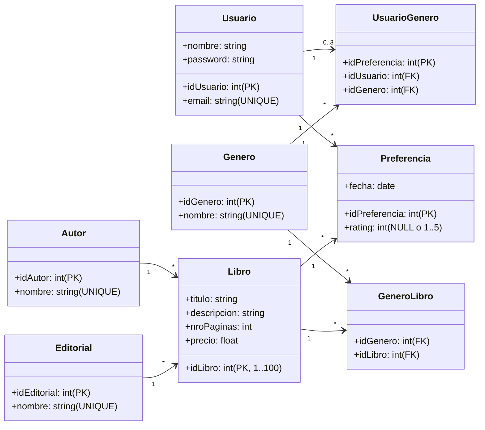

# 🗄️ Documentación del Esquema de Base de Datos (Supabase / PostgreSQL)

Este documento detalla el modelo relacional, las restricciones de integridad y las reglas de negocio implementadas en PostgreSQL sobre la plataforma Supabase para el **Sistema Recomendador Híbrido de Libros**.

---

## 1. Diagrama de Clases / Entidades (UML)

El modelo fue adaptado fielmente al diagrama de clases del paquete `pkg`:



---

## 2. Definición Detallada de Tablas

### `Usuario`
Almacena las credenciales y perfiles de los usuarios de la tienda.
* `idUsuario` (`BIGINT GENERATED BY DEFAULT AS IDENTITY PRIMARY KEY`): Identificador único secuencial.
* `nombre` (`TEXT NOT NULL`): Nombre completo del usuario.
* `email` (`TEXT NOT NULL UNIQUE`): Correo electrónico del usuario (clave única).
* `password` (`TEXT NOT NULL`): Contraseña del usuario.

### `Autor`
Catálogo de autores.
* `idAutor` (`BIGINT GENERATED BY DEFAULT AS IDENTITY PRIMARY KEY`): Identificador único.
* `nombre` (`TEXT NOT NULL UNIQUE`): Nombre del autor (ej. *Isaac Asimov*, *Stephen King*).

### `Editorial`
Catálogo de casas editoriales.
* `idEditorial` (`BIGINT GENERATED BY DEFAULT AS IDENTITY PRIMARY KEY`): Identificador único.
* `nombre` (`TEXT NOT NULL UNIQUE`): Razón social de la editorial (ej. *Minotauro*, *Planeta*).

### `Genero`
Clasificación temática de los libros, pilar para el arranque en frío (*Cold Start*).
* `idGenero` (`BIGINT GENERATED BY DEFAULT AS IDENTITY PRIMARY KEY`): Identificador único.
* `nombre` (`TEXT NOT NULL UNIQUE`): Nombre del género (ej. *Ciencia Ficción*, *Fantasía Épica*).

### `Libro`
Catálogo oficial y cerrado de la tienda.
* `idLibro` (`INT PRIMARY KEY CHECK ("idLibro" >= 1 AND "idLibro" <= 100)`): Identificador restringido por regla de negocio.
* `titulo` (`TEXT NOT NULL`): Título del libro.
* `descripcion` (`TEXT`): Sinopsis o resumen editorial.
* `nroPaginas` (`INT NOT NULL CHECK ("nroPaginas" > 0)`): Número de páginas del ejemplar.
* `precio` (`NUMERIC(10, 2) NOT NULL CHECK ("precio" >= 0)`): Precio de venta.
* `idAutor` (`BIGINT NOT NULL REFERENCES "Autor"("idAutor") ON UPDATE CASCADE ON DELETE RESTRICT`): Clave foránea al autor.
* `idEditorial` (`BIGINT NOT NULL REFERENCES "Editorial"("idEditorial") ON UPDATE CASCADE ON DELETE RESTRICT`): Clave foránea a la editorial.

### `Preferencia`
Captura las interacciones y valoraciones de los usuarios hacia los libros (matriz de utilidad del recomendador).
* `idPreferencia` (`BIGINT GENERATED BY DEFAULT AS IDENTITY PRIMARY KEY`): Identificador de la interacción.
* `rating` (`INT CHECK ("rating" IS NULL OR ("rating" >= 1 AND "rating" <= 5))`):
  * **Explícito:** Valor entero entre 1 y 5 estrellas.
  * **Implícito:** `NULL` (representa clicks, vistas o impresiones sin calificación explícita).
* `fecha` (`DATE DEFAULT CURRENT_DATE`): Fecha del registro.
* `idUsuario` (`BIGINT NOT NULL REFERENCES "Usuario"("idUsuario") ON UPDATE CASCADE ON DELETE CASCADE`): FK al usuario.
* `idLibro` (`INT NOT NULL REFERENCES "Libro"("idLibro") ON UPDATE CASCADE ON DELETE CASCADE`): FK al libro.

### `GeneroLibro` (Tabla Intermedia N:M)
Asocia cada libro con uno o más géneros literarios.
* `idGenero` (`BIGINT REFERENCES "Genero"("idGenero") ON DELETE CASCADE`): FK a Genero.
* `idLibro` (`INT REFERENCES "Libro"("idLibro") ON DELETE CASCADE`): FK a Libro.
* **Clave Primaria:** Compuesta `("idGenero", "idLibro")`.

### `UsuarioGenero` (Tabla Intermedia de Onboarding)
Captura las preferencias iniciales seleccionadas por el usuario al registrarse.
* `idPreferencia` (`BIGINT GENERATED BY DEFAULT AS IDENTITY PRIMARY KEY`): Identificador único de preferencia de género.
* `idUsuario` (`BIGINT REFERENCES "Usuario"("idUsuario") ON DELETE CASCADE`): FK al usuario.
* `idGenero` (`BIGINT REFERENCES "Genero"("idGenero") ON DELETE CASCADE`): FK al género.
* **Restricción:** `UNIQUE("idUsuario", "idGenero")` para no duplicar un mismo género en un usuario.

---

## 3. Reglas de Negocio Enforzadas en PostgreSQL

### A. Catálogo Fijo de 100 Libros (Regla Estricta)
1. **Constraint DDL:** `CHECK ("idLibro" >= 1 AND "idLibro" <= 100)`.
2. **Trigger PL/pgSQL:** Se intercepta cualquier inserción previa a la tabla `Libro`:
   ```sql
   CREATE OR REPLACE FUNCTION check_limite_100_libros()
   RETURNS TRIGGER AS $$
   BEGIN
       IF (SELECT COUNT(*) FROM "Libro") >= 100 THEN
           RAISE EXCEPTION 'Regla de Negocio: El catálogo tiene un límite estricto de exactamente 100 libros.';
       END IF;
       RETURN NEW;
   END;
   $$ LANGUAGE plpgsql;
   ```

### B. Multiplicidad 0..3 en `UsuarioGenero` (Onboarding)
En el diagrama UML se especificó la multiplicidad `0..3`. Para evitar que un usuario seleccione más de 3 géneros favoritos en la base de datos:
```sql
CREATE OR REPLACE FUNCTION check_limite_usuario_genero()
RETURNS TRIGGER AS $$
BEGIN
    IF (SELECT COUNT(*) FROM "UsuarioGenero" WHERE "idUsuario" = NEW."idUsuario") >= 3 THEN
        RAISE EXCEPTION 'Regla de Negocio: Un usuario no puede seleccionar más de 3 géneros favoritos (multiplicidad 0..3).';
    END IF;
    RETURN NEW;
END;
$$ LANGUAGE plpgsql;
```

---

## 4. Índices de Optimización para el Recomendador

Para acelerar las consultas de filtrado colaborativo y similitud de cosenos:
* `idx_preferencia_usuario`: Búsqueda rápida de historial de un usuario.
* `idx_preferencia_libro`: Cálculo de popularidad o promedios por ítem.
* `idx_preferencia_user_item`: Acceso directo al par `(idUsuario, idLibro)` en la matriz de utilidad.
* `idx_generolibro_genero` y `idx_generolibro_libro`: Búsquedas rápidas para recomendaciones basadas en contenido.
* `idx_usuariogenero_user`: Obtención inmediata del perfil de onboarding para resolver el Cold Start.
