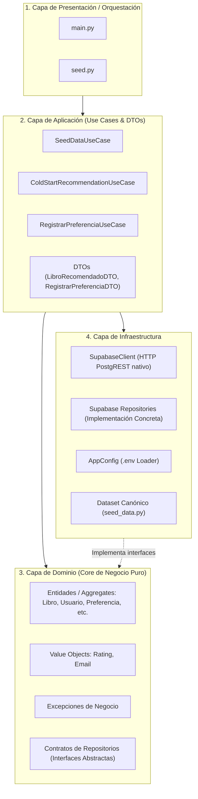

# 🏛️ Arquitectura Orientada al Dominio (Domain-Driven Design - DDD)

Este documento describe la arquitectura de software implementada en el proyecto, siguiendo los patrones de **Domain-Driven Design (DDD)** y principios de **Clean Architecture**.

---

## 1. Visión General de las 4 Capas

---

## 2. Descripción de Capas

### A. Capa de Dominio (`src/domain/`)
Es el corazón del sistema. **No tiene dependencias externas** (no sabe qué es Supabase, SQL, HTTP o JSON).

1. **Entidades / Aggregates:**
   * **`Libro`:** Aggregate Root que protege las invariantes de catálogo:
     * $1 \le id\_libro \le 100$.
     * $nro\_paginas > 0$.
     * $precio \ge 0.0$.
   * **`Usuario`:** Aggregate Root que encapsula los datos del usuario y enforza la multiplicidad del onboarding:
     * Solo permite entre 0 y 3 géneros favoritos. Si se intenta agregar un 4º, lanza `MultiplicidadGenerosExcedidaException`.
   * **`Preferencia`:** Modela la relación usuario-libro con su respectivo rating y fecha.
   * **`Autor`, `Editorial`, `Genero`:** Entidades base que componen el catálogo.

2. **Value Objects:**
   * **`Rating`:** Inmutable. Puede ser explícito ($1 \le valor \le 5$) o implícito (`valor = None`). Lanza `RatingInvalidoException` ante valores fuera de rango.
   * **`Email`:** Inmutable. Valida la estructura sintáctica del correo.

3. **Contratos de Repositorio ([`contracts.py`](file:///c:/Users/Pablo%20Leal/Documents/Github/Sistema-Recomendador/src/domain/repositories/contracts.py)):**
   * Interfaces abstractas (`ILibroRepository`, `IUsuarioRepository`, `IGeneroRepository`, etc.) que dictan qué operaciones necesita el dominio, aplicando **Inversión de Control (IoC)**.

---

### B. Capa de Aplicación (`src/application/`)
Coordina el flujo de datos y orquesta las entidades de dominio para resolver casos de uso concretos del negocio.

* **[`SeedDataUseCase`](file:///c:/Users/Pablo%20Leal/Documents/Github/Sistema-Recomendador/src/application/use_cases/seed_data_use_case.py):**
  * Orquesta la verificación y poblado de los 12 géneros, 9 editoriales, 18 autores, 100 libros exactos y 20 usuarios con sus preferencias de onboarding.
* **[`ColdStartRecommendationUseCase`](file:///c:/Users/Pablo%20Leal/Documents/Github/Sistema-Recomendador/src/application/use_cases/cold_start_recommendation_use_case.py):**
  * Resuelve la recomendación para usuarios nuevos consultando los géneros seleccionados en el onboarding y mapeando libros coincidentes ordenados.
* **[`RegistrarPreferenciaUseCase`](file:///c:/Users/Pablo%20Leal/Documents/Github/Sistema-Recomendador/src/application/use_cases/registrar_preferencia_use_case.py):**
  * Registra interacciones de usuarios hacia libros (tanto calificaciones de 1 a 5 estrellas como eventos implícitos de navegación).
* **Data Transfer Objects ([`dtos.py`](file:///c:/Users/Pablo%20Leal/Documents/Github/Sistema-Recomendador/src/application/dtos.py)):**
  * `LibroRecomendadoDTO` y `RegistrarPreferenciaDTO`, que desacoplan la salida hacia la presentación sin exponer las entidades internas del dominio.

---

### C. Capa de Infraestructura (`src/infrastructure/`)
Implementa los detalles técnicos y adapta el dominio al mundo exterior (Supabase, variables de entorno, APIs).

* **[`SupabaseClient`](file:///c:/Users/Pablo%20Leal/Documents/Github/Sistema-Recomendador/src/infrastructure/supabase/client.py):**
  * Cliente HTTP nativo utilizando `urllib.request`. No requiere librerías externas para conectarse a la API PostgREST de Supabase (`GET`, `POST`, `DELETE`).
* **[`supabase_repositories.py`](file:///c:/Users/Pablo%20Leal/Documents/Github/Sistema-Recomendador/src/infrastructure/repositories/supabase_repositories.py):**
  * Implementaciones concretas de las interfaces de dominio (`SupabaseLibroRepository`, `SupabaseUsuarioRepository`, etc.). Mapean diccionarios JSON a Entidades de Dominio.
* **[`config.py`](file:///c:/Users/Pablo%20Leal/Documents/Github/Sistema-Recomendador/src/infrastructure/config.py):**
  * Carga y valida tipadamente `SUPABASE_URL` y `SUPABASE_KEY` desde el archivo `.env`.
* **[`seed_data.py`](file:///c:/Users/Pablo%20Leal/Documents/Github/Sistema-Recomendador/src/infrastructure/data/seed_data.py):**
  * Módulo con las tuplas y diccionarios originales del trabajo integrador.

---

### D. Capa de Presentación / Orquestación
Puntos de entrada ejecutables:
* **[`main.py`](file:///c:/Users/Pablo%20Leal/Documents/Github/Sistema-Recomendador/main.py):** Realiza la inyección de dependencias manual y ejecuta una demostración completa de los casos de uso.
* **[`seed.py`](file:///c:/Users/Pablo%20Leal/Documents/Github/Sistema-Recomendador/seed.py):** Script de mantenimiento para poblar o reiniciar la base de datos en Supabase.
