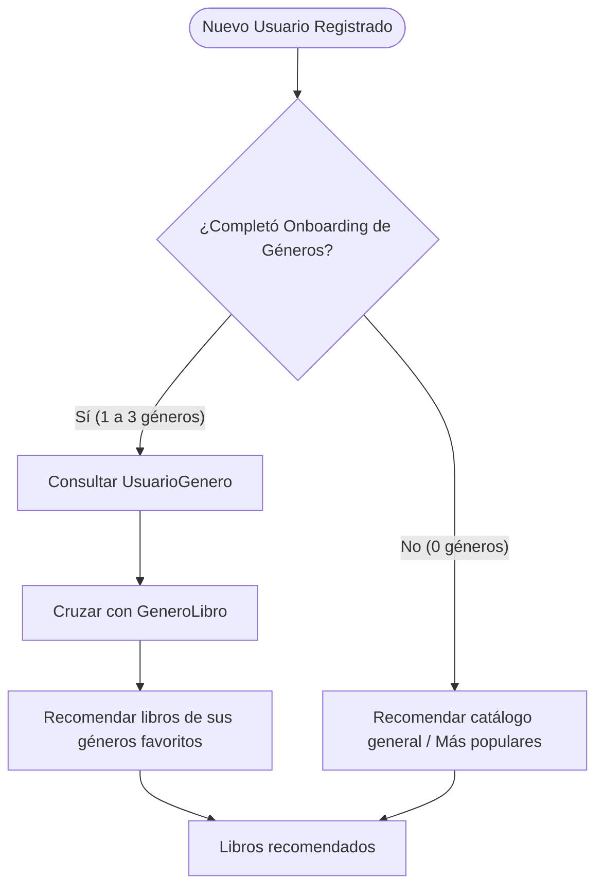

# 🚀 Datos Semilla y Mitigación del Problema de Cold Start

Este documento describe el conjunto de datos integrado en el proyecto y la estrategia algorítmica para mitigar el problema de **Arranque en Frío (Cold Start)** en nuevos usuarios.

---

## 1. El Dataset Integrado (100 Libros Reales)

Todos los registros fueron extraídos fielmente del notebook original del Trabajo Práctico Integrador y residen de forma canónica en [`src/infrastructure/data/seed_data.py`](../src/infrastructure/data/seed_data.py).

### Resumen Cuantitativo
| Colección | Cantidad | Descripción |
| :--- | :---: | :--- |
| **`Genero`** | **12** | *Ciencia Ficción, Fantasía Épica, Novela Policial, Terror y Suspenso, Desarrollo Personal, Divulgación Científica, Historia Universal, Filosofía, Realismo Mágico, Distopía, Biografía y Memorias, Tecnología y Software.* |
| **`Editorial`** | **9** | *Penguin Random House, Editorial Planeta, Minotauro, Alianza Editorial, Fondo de Cultura Económica, Anagrama, O'Reilly Media, Tusquets Editores, Editorial Sudamericana.* |
| **`Autor`** | **18** | *Isaac Asimov, J.R.R. Tolkien, Agatha Christie, Stephen King, James Clear, Carl Sagan, Yuval Noah Harari, Friedrich Nietzsche, Gabriel García Márquez, George Orwell, Walter Isaacson, Robert C. Martin, Arthur C. Clarke, Brandon Sanderson, Arthur Conan Doyle, H.P. Lovecraft, Jorge Luis Borges, Martin Fowler.* |
| **`Libro`** | **100** | Catálogo oficial fijo con títulos reales, cantidad de páginas exactas (`nroPaginas`), precios y descripciones literarias. |
| **`GeneroLibro`** | **130** | Relaciones Many-to-Many entre cada libro y sus géneros temáticos (1 a 2 géneros por obra). |
| **`Usuario`** | **20** | Perfiles de usuarios con nombre, correo electrónico y contraseña. |
| **`UsuarioGenero`** | **22** | Asignaciones de géneros favoritos de onboarding (respetando la regla de negocio de 0 a 3 géneros por usuario). |

---

## 2. Mitigación del Problema de Cold Start (Arranque en Frío)

### El Desafío
En un sistema recomendador basado puramente en filtrado colaborativo, cuando un usuario nuevo se registra en la plataforma:
$$\text{Historial}(\text{usuario}_{\text{nuevo}}) = \emptyset$$
Al no poseer valoraciones previas en la matriz de utilidad, los modelos tradicionales (como SVD o factorización matricial) no pueden calcular similitudes con otros usuarios o ítems.

### La Solución Implementada
La arquitectura resuelve este problema mediante un enfoque híbrido en dos fases:



1. **Onboarding Temático (`UsuarioGenero`):** Al registrarse, el usuario selecciona hasta 3 géneros de su preferencia (invariante $0..3$).
2. **Recomendación Basada en Contenido:** La función `recomendar()` de [`src/supabase_operations.py`](../src/supabase_operations.py) recupera los libros clasificados bajo esos géneros (`GeneroLibro`) y entrega recomendaciones personalizadas desde el segundo cero.
3. **Fallback por Catálogo:** Si el usuario decide omitir el onboarding ($0$ géneros seleccionados), `recomendar()` entrega una selección del catálogo general.

---

## 3. Feedback Explícito vs. Implícito (`Preferencia`)

La tabla `Preferencia` permite alimentar el modelo a medida que el usuario interactúa con la plataforma:

* **Feedback Explícito:** Calificación voluntaria en estrellas ($1, 2, 3, 4, 5$). Modela preferencias directas del usuario.
* **Feedback Implícito:** Evento de click, vista de ficha de libro o tiempo de lectura donde `rating = None`. En ciencia de datos, estas interacciones se convierten en señales de confianza binarias o ponderadas para refinar el filtrado colaborativo una vez superada la fase de Cold Start.

---

## 4. Guía de Ejecución y Pruebas

### Reiniciar y Repoblar Supabase desde Cero
Si deseas limpiar las tablas y reinyectar todos los datos limpios:
```powershell
py seed.py --reset
```

### Reiniciar solo las preferencias de usuarios existentes
Para borrar las relaciones de géneros y compras de los usuarios actuales y volver a generarlas:
```powershell
py .\seed_preferencias.py --reset-preferencias
```
El usuario `emilianolanaro@gmail.com` queda sin compras para probar el caso Cold Start. Usar este comando solo con datos de prueba.

### Ejecutar Caso de Uso de Recomendaciones
Para ejecutar el recomendador y observar cómo se calculan las recomendaciones de Cold Start para un usuario en vivo:
```powershell
py main.py
```
