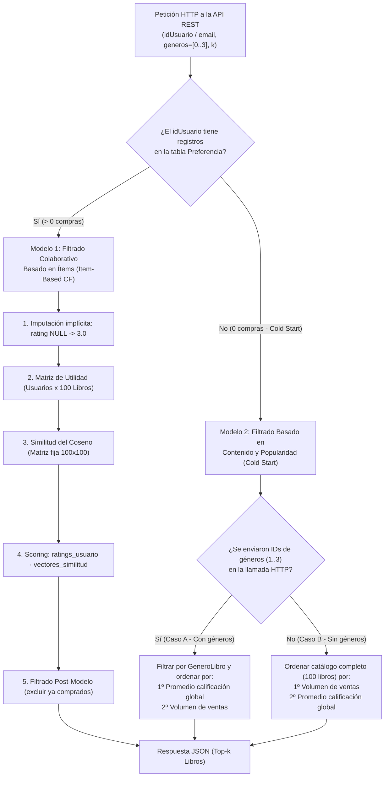

# 🧠 Fase 4: Modelado Híbrido y Documentación de la API REST

Este documento describe la implementación matemática y algorítmica de la **Fase 4: Modelado**, el pipeline de ensamblado de transformaciones en Python y el catálogo completo de **endpoints y URLs HTTP de la API REST** listos para probar.

---

## 1. Arquitectura de los Modelos (Solución Híbrida)

El sistema integra dos modelos complementarios orquestados por el pipeline [`HybridRecommenderPipeline`](../src/models/hybrid_pipeline.py):



---

### 1.1. Modelo 1: Filtrado Colaborativo Basado en Ítems (`Item-Based CF`)
Implementado en [`src/models/item_based_cf.py`](../src/models/item_based_cf.py) (`ItemBasedCFModel`):

1. **Datos de entrada:** Se consulta la tabla `Preferencia` extrayendo `idUsuario`, `idLibro` y `rating`.
2. **Preprocesamiento e imputación de retroalimentación implícita:** Toda compra confirmada que carezca de calificación explícita (`rating IS NULL`) se imputa automáticamente con el valor numérico **`3.0`**.
3. **Construcción de la matriz de utilidad ($U \times 100$):** Se pivotan las interacciones formando una matriz donde las filas son los usuarios (`idUsuario`), las columnas son los 100 libros fijos del catálogo (`idLibro` de `1` a `100`) y las celdas contienen el rating explícito (`1..5`) o imputado (`3.0`), y `0.0` en ausencia de compra.
4. **Cálculo de similitud ($100 \times 100$):** Se aplica la **Similitud del Coseno** entre los vectores columna de los 100 libros:
   $$\text{sim}(i, j) = \frac{\vec{v}_i \cdot \vec{v}_j}{\|\vec{v}_i\| \cdot \|\vec{v}_j\|}$$
5. **Generación de puntajes (Scoring):** Para el usuario activo $u$, se multiplican los ratings de sus libros comprados por los vectores de similitud correspondientes en la matriz $100 \times 100$:
   $$\text{score}(u, j) = \sum_{i \in \text{Comprados}(u)} r_{u,i} \cdot \text{sim}(i, j)$$
6. **Filtrado Post-Modelo:** Se eliminan del ranking final todos los libros que el usuario ya compró previamente y se retorna el `Top-k` ordenado descendentemente.

---

### 1.2. Modelo 2: Filtrado Basado en Contenido y Popularidad (`Cold Start`)
Implementado en [`src/models/cold_start.py`](../src/models/cold_start.py) (`ColdStartModel`):

1. **Verificación de estado:** Se comprueba si el `idUsuario` tiene registros en `Preferencia`. Si no posee compras previas (por ejemplo, `emilianolanaro@gmail.com`, `idUsuario = 36`), se activa este modelo de contingencia.
2. **Extracción de perfiles (Onboarding por HTTP):** El endpoint recibe dinámicamente un arreglo con hasta 3 IDs de géneros (`generos`), evitando consultas adicionales a `UsuarioGenero`.
3. **Caso A (Con géneros):** Si la petición HTTP incluye entre 1 y 3 IDs de géneros, se filtran los libros asociados en `GeneroLibro` y se ordenan descendentemente por **promedio de calificaciones globales** y **volumen de ventas**.
4. **Caso B (Sin géneros):** Si el usuario omitió la selección de géneros (`generos` vacío o no enviado), se ordena el catálogo completo de 100 libros por **volumen de ventas (más vendidos)** y **promedio de calificaciones globales (mejor valorados)**.

---

## 2. Cómo Iniciar la API REST

Desde la raíz del proyecto, ejecuta:

```powershell
py api.py
```

Por defecto, el servidor levanta en:
* **URL Base:** `http://127.0.0.1:8000`

*(Opcionalmente puedes cambiar el puerto con `py api.py --port 8080`).*

---

## 3. Catálogo de Endpoints de la API REST

| Método HTTP | Endpoint | Descripción |
| :---: | :--- | :--- |
| `GET` | `/api/health` | Estado del servidor, métricas cargadas y dimensión de la matriz (`100x100`). |
| `GET` / `POST` | `/api/recomendaciones` | **Endpoint Híbrido Principal:** Detecta automáticamente si usar Modelo 1 (CF) o Modelo 2 (Cold Start Caso A / Caso B). |
| `GET` / `POST` | `/api/modelo/colaborativo` | Ejecuta directamente el **Modelo 1 (Item-Based CF)** para un usuario con compras. |
| `GET` / `POST` | `/api/modelo/cold-start` | Ejecuta directamente el **Modelo 2 (Cold Start)** con géneros (Caso A) o sin géneros (Caso B). |
| `GET` | `/api/modelo/matriz-similitud` | Inspecciona la matriz $100 \times 100$ de Similitud del Coseno o devuelve los libros más similares a un `id_libro`. |
| `POST` | `/api/preferencias` | Registra una nueva compra/calificación en Supabase y actualiza la matriz $100 \times 100$ en memoria. |
| `POST` | `/api/modelo/reentrenar` | Recarga todas las tablas desde Supabase y recalcula los modelos. |
| `GET` | `/api/usuarios` | Lista todos los usuarios indicando su `idUsuario`, cantidad de compras y si están en estado Cold Start. |
| `GET` | `/api/generos` | Lista los 12 géneros disponibles con su `idGenero` y su posición (`1..12`). |
| `GET` | `/api/libros` | Lista los 100 libros del catálogo con su `volumen_ventas` y `promedio_rating`. |

---

## 4. URLs HTTP y Comandos para Probar cada Caso

Una vez iniciado el servidor con `py api.py`, puedes abrir estas URLs directamente en tu **navegador**, en **Postman**, o ejecutarlas desde **PowerShell**.

### 4.1. Health Check y Consultas Auxiliares

* **Verificar estado del servidor y de la matriz 100x100:**
  ```text
  http://127.0.0.1:8000/api/health
  ```
* **Ver lista de usuarios (con compras vs. Cold Start) y sus IDs:**
  ```text
  http://127.0.0.1:8000/api/usuarios
  ```
* **Ver lista de géneros y sus IDs:**
  ```text
  http://127.0.0.1:8000/api/generos
  ```

---

### 4.2. Probar el Endpoint Híbrido Principal (`/api/recomendaciones`)

#### A) Usuario Recurrente con Compras $\rightarrow$ Activa Modelo 1 (Item-Based CF)
En la base de datos actual, el usuario `pabloleal@gmail.com` (`idUsuario = 37`) posee compras registradas (algunas con rating explícito y otras con `rating = NULL` que el modelo imputa automáticamente con `3.0`):

* **URL HTTP (`GET`) por `id_usuario`:**
  ```text
  http://127.0.0.1:8000/api/recomendaciones?id_usuario=37&k=5
  ```
* **URL HTTP (`GET`) por `email`:**
  ```text
  http://127.0.0.1:8000/api/recomendaciones?email=pabloleal@gmail.com&k=5
  ```
* **Prueba con `POST` en PowerShell:**
  ```powershell
  Invoke-RestMethod -Method Post -Uri "http://127.0.0.1:8000/api/recomendaciones" `
    -ContentType "application/json" `
    -Body '{"idUsuario": 37, "k": 5}' | ConvertTo-Json -Depth 6
  ```

---

#### B) Usuario Nuevo sin Compras + Con Géneros de Onboarding $\rightarrow$ Activa Modelo 2 (Cold Start - Caso A)
El usuario `emilianolanaro@gmail.com` (`idUsuario = 36`) no tiene compras en `Preferencia`. Pasando hasta 3 IDs de géneros en la llamada HTTP (por ejemplo `13,14` o sus posiciones `1,2` para *Ciencia Ficción* y *Fantasía Épica*):

* **URL HTTP (`GET`) con IDs de géneros:**
  ```text
  http://127.0.0.1:8000/api/recomendaciones?id_usuario=36&generos=13,14&k=5
  ```
  *(También acepta posiciones del 1 al 12: `http://127.0.0.1:8000/api/recomendaciones?id_usuario=36&generos=1,2&k=5`)*

* **Prueba con `POST` en PowerShell (enviando arreglo de hasta 3 géneros):**
  ```powershell
  Invoke-RestMethod -Method Post -Uri "http://127.0.0.1:8000/api/recomendaciones" `
    -ContentType "application/json" `
    -Body '{"idUsuario": 36, "generos": [13, 14], "k": 5}' | ConvertTo-Json -Depth 6
  ```

---

#### C) Usuario Nuevo sin Compras + Sin Géneros $\rightarrow$ Activa Modelo 2 (Cold Start - Caso B: Popularidad Global)
Si el usuario en estado Cold Start (`idUsuario = 36`) omitió la selección de géneros en el onboarding:

* **URL HTTP (`GET`):**
  ```text
  http://127.0.0.1:8000/api/recomendaciones?id_usuario=36&k=5
  ```
* **Prueba con `POST` en PowerShell:**
  ```powershell
  Invoke-RestMethod -Method Post -Uri "http://127.0.0.1:8000/api/recomendaciones" `
    -ContentType "application/json" `
    -Body '{"idUsuario": 36, "generos": [], "k": 5}' | ConvertTo-Json -Depth 6
  ```

---

### 4.3. Probar cada Modelo por Separado

* **Endpoint exclusivo del Modelo 1 (Filtrado Colaborativo Item-Based CF):**
  ```text
  http://127.0.0.1:8000/api/modelo/colaborativo?id_usuario=37&k=5
  ```
* **Endpoint exclusivo del Modelo 2 (Cold Start - Caso A con 3 géneros):**
  ```text
  http://127.0.0.1:8000/api/modelo/cold-start?generos=1,2,3&k=5
  ```
* **Endpoint exclusivo del Modelo 2 (Cold Start - Caso B sin géneros / Más vendidos):**
  ```text
  http://127.0.0.1:8000/api/modelo/cold-start?k=5
  ```

---

### 4.4. Inspeccionar la Matriz de Similitud del Coseno ($100 \times 100$)

* **Resumen general y submatriz $5 \times 5$:**
  ```text
  http://127.0.0.1:8000/api/modelo/matriz-similitud
  ```
* **Ver los 5 libros matemáticamente más similares al Libro #1 (*Fundación*):**
  ```text
  http://127.0.0.1:8000/api/modelo/matriz-similitud?id_libro=1&k=5
  ```

---

### 4.5. Registrar una Nueva Compra / Preferencia (`POST /api/preferencias`)

* **Compra con calificación explícita (`rating = 5`):**
  ```powershell
  Invoke-RestMethod -Method Post -Uri "http://127.0.0.1:8000/api/preferencias" `
    -ContentType "application/json" `
    -Body '{"idUsuario": 37, "idLibro": 10, "rating": 5}' | ConvertTo-Json -Depth 5
  ```
* **Compra sin calificación (`rating = null`, se imputa con `3.0` en el modelo):**
  ```powershell
  Invoke-RestMethod -Method Post -Uri "http://127.0.0.1:8000/api/preferencias" `
    -ContentType "application/json" `
    -Body '{"idUsuario": 37, "idLibro": 12, "rating": null}' | ConvertTo-Json -Depth 5
  ```
